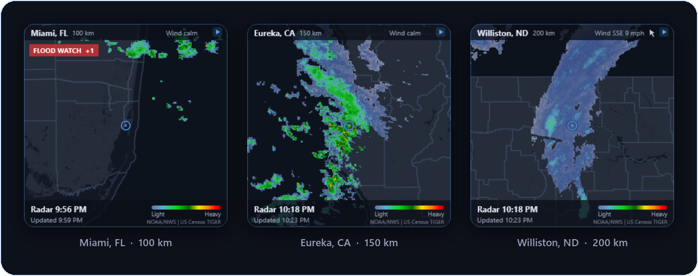
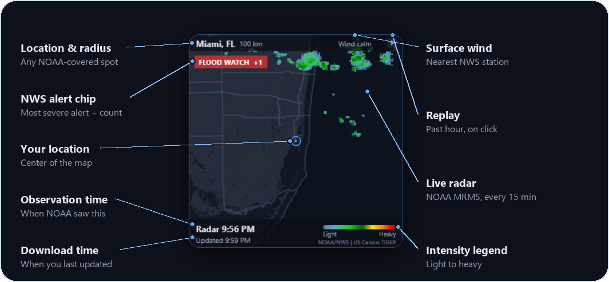
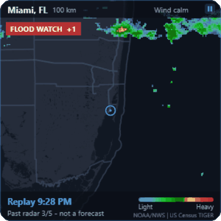
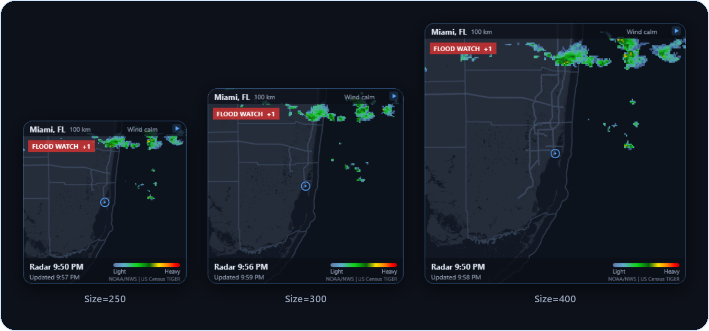
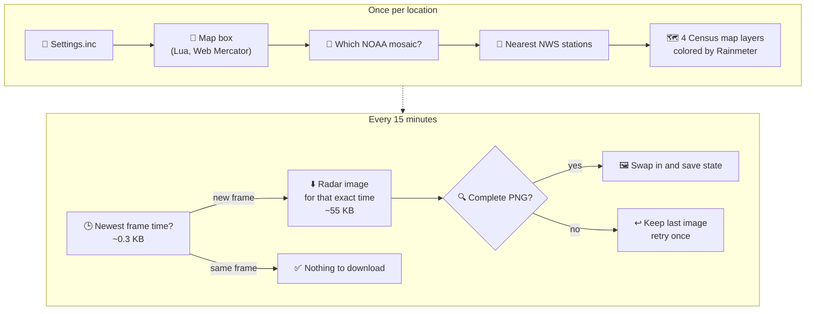

<p align="center">
  
</p>

<p align="center">
  <a href="https://github.com/DabRig/Desktop-Weather-Radar/releases/latest"></a>
  <a href="https://github.com/DabRig/Desktop-Weather-Radar/releases"></a>
  <a href="https://www.rainmeter.net/"></a>
  
  <a href="https://www.weather.gov/"></a>
  <a href="LICENSE"></a>
</p>

<p align="center">
  <b>A tiny, dark radar widget that shows real NOAA/NWS precipitation around any place you pick:<br>
  on a real map, refreshed every 15 minutes, honest about how old it is, and light on your PC.</b>
</p>

<p align="center">
  <a href="https://github.com/DabRig/Desktop-Weather-Radar/releases/latest"></a>
</p>

<p align="center">
  <a href="#-features">Features</a> ·
  <a href="#-install-in-30-seconds">Install</a> ·
  <a href="#-set-your-location">Location</a> ·
  <a href="#%EF%B8%8F-how-it-works">How it works</a> ·
  <a href="#-light-on-your-pc">Performance</a> ·
  <a href="#-faq">FAQ</a>
</p>

<p align="center">
  
</p>
<p align="center"><sub>Real captures from the same evening: Miami (100 km), Eureka (150 km) and Williston (200 km). Pick any spot NOAA covers.</sub></p>

---

## ✨ Features

<table>
<tr>
<td width="50%" valign="top">

### 📡 Official, live radar
NOAA/NWS **MRMS** base reflectivity, NOAA's national multi-radar mosaic, updated every few minutes, on a clean US Census map that lines up with the radar to within **1 m**.

</td>
<td width="50%" valign="top">

### ⏱️ Honest about time
Shows when NOAA **observed** the radar *and* when you last **downloaded** it. Old images are dimmed and marked <kbd>STALE</kbd> or <kbd>OFFLINE</kbd>.

</td>
</tr>
<tr>
<td valign="top">

### 🪶 Light by design
About **+3 MB** of memory, no extra programs, no services, no startup entries. It downloads only when NOAA has a **new** frame, about 55 KB each.

</td>
<td valign="top">

### 🧩 Zero setup scripts
Double-click the `.rmskin`, type your coordinates, refresh. The skin finds your radar region, nearest stations and map on its own in about **1.5 s**.

</td>
</tr>
<tr>
<td valign="top">

### 🌬️ Surface wind
"Wind ESE 14 mph" from the nearest NWS station, with an arrow showing where the air is heading. If a station has no reading, it tries the next closest.

</td>
<td valign="top">

### ⚠️ NWS alerts
A color-coded chip like <kbd>FLOOD WATCH +2</kbd> for active watches, warnings and advisories at your exact point. Hover for the list, click for details.

</td>
</tr>
<tr>
<td valign="top">

### 🎬 Past-hour replay
Optional ▶ button that replays up to 8 observed frames. It downloads only frames it doesn't have and stops by itself.

</td>
<td valign="top">

### 🛡️ Built to fail gracefully
Server errors, half-downloads, sleep/resume and no internet are all handled: your last good image stays put, with one polite retry and no request loops.

</td>
</tr>
</table>

## 🧭 What you're looking at

<p align="center">
  
</p>

## 🎬 Replay the past hour

<table>
<tr>
<td width="380"></td>
<td valign="middle">

Set `AnimationEnabled=1` and a ▶ appears in the title bar.

- **Click** to play up to 8 frames from the last hour; **click again** to pause.
- Frames are **cached**: a second replay a minute later downloads nothing.
- It **stops by itself** after a few loops and returns to live.
- Clearly labelled **"Replay … not a forecast"**.

</td>
</tr>
</table>

## ⚡ Install in 30 seconds

1. Install **[Rainmeter](https://www.rainmeter.net/)** 4.5 or newer (free, Windows 10/11).
2. Download **`DesktopRadar_1.0.0.rmskin`** from **[Releases](https://github.com/DabRig/Desktop-Weather-Radar/releases/latest)** and double-click it.
3. Click **Install**. The widget appears showing Miami, FL. Drag it anywhere.

> [!IMPORTANT]
> **Coverage:** NOAA radar covers the **contiguous US, Alaska, Hawaii, Puerto Rico / the Caribbean and Guam**.
> Anywhere else the widget tells you *"No NOAA radar covers this location"*.

## 📍 Set your location

Right-click the widget → **Open folder** → open `@Resources\Settings.inc` in any text editor:

```ini
LocationName=Denver, CO
Latitude=39.7392
Longitude=-104.9903
RadiusKm=100
```

Save, then right-click → **Refresh skin**. Done: it sets itself up for the new place.

> [!TIP]
> Get coordinates from Google Maps: right-click any spot, then click the numbers at the top of the menu to copy them.

<details>
<summary><b>⚙️ All settings</b></summary>

| Setting | Default | What it does |
|---|---|---|
| `LocationName` | `Miami, FL` | Title text |
| `Latitude`, `Longitude` | `25.7617`, `-80.1918` | Center of the map (west is negative) |
| `RadiusKm` | `100` | Center-to-edge distance, 25–500 km |
| `Size` | `300` | Widget size, 250–400 px |
| `RefreshMinutes` | `15` | How often to check for new radar, 5–60 |
| `StaleMinutes` | `35` | When to mark the radar STALE |
| `RadarAlpha` | `215` | Radar opacity, 0–255 |
| `ShowWind` | `1` | Surface wind from the nearest NWS station |
| `WindUnits` | `mph` | `mph`, `kmh` or `kt` |
| `ShowAlerts` | `1` | Active NWS watches, warnings and advisories |
| `AnimationEnabled` | `0` | `1` adds the ▶ replay button |
| `AnimMinutes`, `AnimFrames` | `60`, `8` | Replay length and frame count |
| `DebugLog` | `0` | `1` writes a troubleshooting log |

</details>

<p align="center">
  
</p>

## 🛰️ How it works



- **Exact-time downloads.** Every image is requested for the newest frame's timestamp, so a cache can never hand you an old picture, and the observation time is always the real one.
- **Two-slot cache.** New images download into the slot that *isn't* on screen and are swapped in only after passing a PNG header *and* end-of-file check.
- **No extra processes.** Everything runs inside Rainmeter's own WebParser plus a small Lua script. No PowerShell, Python or browser engine at runtime.
- **Sleep-aware.** A long gap between ticks means the PC slept, so it checks once, 30 s after waking.

More detail in **[docs/ARCHITECTURE.md](docs/ARCHITECTURE.md)**.

## 🪶 Light on your PC

Measured on a real Windows 11 PC with Rainmeter already running three other skins ([full results](docs/BENCHMARKS.md)):

| | Without DesktopRadar | With DesktopRadar |
|---|---|---|
| 🧠 Memory (private) | 17.8–24.4 MB | **+2.6 to +3.9 MB** |
| ⚙️ CPU at rest | within noise | **no measurable difference** |
| 🚀 Rainmeter startup | 334 ms (avg) | **364 ms** (+30 ms) |
| 🌐 Network | | **about 5 MB/day** radar-only, 7–8 MB/day with wind and alerts |
| 🎬 Replay playing | | about 1–2% of one CPU core, only while playing |

No registry changes, services, scheduled tasks or startup entries. Uninstalling is deleting one folder.

## 🧪 Tested

| Suite | What it checks | Result |
|---|---|---|
| **Behavior** (inside real Rainmeter, local fake NOAA) | errors, offline, stale, restart, cache slots, sleep/resume, wind, alerts, replay, first-time setup, out-of-coverage | **75/75** ✅ |
| **Live data** | NOAA frame times, image export, radar-to-map alignment, NWS links | **12/12** ✅ |
| **Install & removal** | `.rmskin` through Rainmeter's own installer, sizes 250–400, clean uninstall | ✅ |

## ❓ FAQ

<details>
<summary><b>Is this a forecast?</b></summary>

No. It shows **observed** radar from the last few minutes, and the replay shows the past hour. For forecasts and warnings, use [weather.gov](https://www.weather.gov/).
</details>

<details>
<summary><b>Does the wind arrow show where storms are going?</b></summary>

No. It's **surface wind** at the nearest weather station (ground level). Storms are steered by winds higher up, so DesktopRadar deliberately doesn't draw storm-motion arrows.
</details>

<details>
<summary><b>It says "Setting up location…" and nothing happens</b></summary>

Check your internet connection. Setup retries every 3 minutes. If a setting is out of range you'll see *"Check Settings.inc: …"* naming it.
</details>

<details>
<summary><b>No rain is showing</b></summary>

If the times keep updating, there's simply no precipitation in view. Try a larger `RadiusKm`.
</details>

<details>
<summary><b>Does it work outside the US? On macOS?</b></summary>

The radar is NOAA's, so only NOAA-covered areas work (see Coverage above). Rainmeter is Windows-only; a macOS version ([Übersicht](https://tracesof.net/uebersicht/)) is planned.
</details>

<details>
<summary><b>How do I uninstall it?</b></summary>

Right-click → **Unload skin**, then delete the `DesktopRadar` folder from your Rainmeter `Skins` folder. Nothing else is left behind.
</details>

<details>
<summary><b>🛠️ For developers</b></summary>

```text
skin/DesktopRadar/   the skin: Radar.ini + @Resources/Radar.lua + Settings.inc
tools/               Install-Skin, Uninstall-Skin, Update-Location, Build-Release (.rmskin)
tests/               Verify-Radar (live), Test-SkinBehavior (Rainmeter + fake NOAA), Measure-Overhead
docs/                ARCHITECTURE, BENCHMARKS, images
```

```powershell
powershell -ExecutionPolicy Bypass -File tools\Install-Skin.ps1 -Load       # install from source
powershell -ExecutionPolicy Bypass -File tests\Verify-Radar.ps1              # live data checks
powershell -ExecutionPolicy Bypass -File tests\Test-SkinBehavior.ps1         # behavior suite (needs Node.js)
powershell -ExecutionPolicy Bypass -File tools\Build-Release.ps1             # build the .rmskin
```

The PowerShell scripts target Windows PowerShell 5.1. The behavior suite runs a temporary copy of the skin inside Rainmeter against `tests/mock-noaa.js`, which serves real NOAA/NWS replies saved in `tests/fixtures`, then removes it.
</details>

## 🙏 Credits

- **Radar, wind and alerts:** [NOAA / National Weather Service](https://www.weather.gov/) (MRMS via [mapservices.weather.noaa.gov](https://mapservices.weather.noaa.gov/), [api.weather.gov](https://www.weather.gov/documentation/services-web-api)).
- **Map:** [U.S. Census Bureau TIGERweb](https://tigerweb.geo.census.gov/).
- **Built with** [Rainmeter](https://www.rainmeter.net/).

> [!NOTE]
> DesktopRadar is a fan-made skin and is not affiliated with or endorsed by NOAA or the National Weather Service. NOAA/NWS and Census data are public-domain U.S. Government works.

<p align="center">
  <sub>MIT licensed · made for the Rainmeter community · if it's useful to you, a ⭐ helps others find it</sub>
</p>

<p align="center">
  <a href="https://buymeacoffee.com/sebastiansuccess"></a>
</p>
