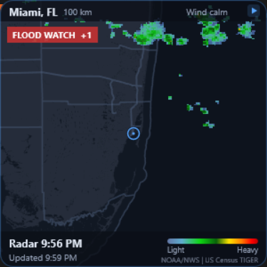

# DesktopRadar

A small, dark weather-radar widget for your Windows desktop, made with
[Rainmeter](https://www.rainmeter.net/). It shows recent official NOAA/NWS radar around any
location you choose, on a real map, and refreshes every 15 minutes.



- **Official data:** NOAA/NWS radar (MRMS), NWS surface wind and NWS alerts. Map from the US Census. All public domain.
- **Light on your PC:** about 3 MB of memory, and no extra programs, services or startup entries. It runs inside Rainmeter. ([measurements](docs/BENCHMARKS.md))
- **Honest about time:** it shows when the radar was *observed* and when you last *downloaded* it, separately. Old images are dimmed and marked STALE or OFFLINE.
- **Optional extras:** surface wind, an NWS alert chip, and a replay of the past hour.

> **Coverage:** NOAA radar covers the **contiguous US, Alaska, Hawaii, Puerto Rico / the Caribbean and Guam**.
> Anywhere else, the widget says "No NOAA radar covers this location".

> DesktopRadar is a fan-made skin. It is not affiliated with or endorsed by NOAA or the National
> Weather Service. It shows **observed** radar, not a forecast. For warnings and safety decisions,
> use [weather.gov](https://www.weather.gov/).

## Install
1. Install [Rainmeter](https://www.rainmeter.net/) 4.5 or newer (Windows 10 or 11).
2. Download `DesktopRadar_1.0.0.rmskin` from [Releases](../../releases) and double-click it.
3. Click **Install**. The widget appears showing Miami, FL.

The first load takes a few seconds. The skin looks up your area and downloads its map once.

## Set your location
Right-click the widget → **Open folder**, open `@Resources\Settings.inc` in any text editor,
and change:

```ini
LocationName=Denver, CO
Latitude=39.7392
Longitude=-104.9903
```

Save, then right-click → **Refresh skin**. The widget sets itself up for the new place. You can
copy coordinates from Google Maps: right-click a spot and click the numbers at the top.

| Setting | Default | What it does |
|---|---|---|
| `LocationName` | Miami, FL | Title text |
| `Latitude`, `Longitude` | 25.7617, -80.1918 | Center of the map (west is negative) |
| `RadiusKm` | 100 | Distance from the center to the edge (25–500) |
| `Size` | 300 | Widget size in pixels (250–400) |
| `RefreshMinutes` | 15 | How often to check for new radar (5–60) |
| `StaleMinutes` | 35 | When to mark the radar STALE |
| `RadarAlpha` | 215 | Radar opacity, 0–255 |
| `ShowWind` | 1 | Surface wind from the nearest NWS station |
| `WindUnits` | mph | `mph`, `kmh` or `kt` |
| `ShowAlerts` | 1 | Active NWS watches, warnings and advisories |
| `AnimationEnabled` | 0 | `1` adds a play button that replays the past hour |

## Using it
- **Click the map** to open the official NWS radar for your nearest station.
- **Right-click** for **Refresh radar now** and **Open NWS forecast and alerts**.
- **Alert chip:** shows the most severe active alert plus a count, e.g. "FLOOD WATCH +2". Red means
  Severe/Extreme, amber Moderate, blue Minor. Hover for the list, click for details.
- **Wind:** e.g. "Wind ESE 14 mph". The text is where the wind comes *from*; the arrow points where
  it's going. It's ground-level wind, not the direction storms are moving. If the nearest station
  has no reading, the next of the 3 closest is used.
- **Replay** (when enabled): click ▶ to play the past hour of observed radar, click again to pause.
  It downloads only frames it doesn't have, and stops by itself.

  

## Troubleshooting
- **"Setting up location…" doesn't finish:** check your internet connection. The skin retries
  every 3 minutes.
- **"Check Settings.inc: …":** a setting is out of range; the message names it.
- **No rain shown but the times update:** there's probably no precipitation nearby.
- **OFFLINE badge:** NOAA couldn't be reached. The last image stays on screen. The skin retries
  once after 3 minutes, then on schedule. It never hammers the servers.
- **Something looks wrong:** set `DebugLog=1` in Settings.inc and refresh. A log is written to
  `DownloadFile\debug.log` inside the skin folder. Set it back to 0 afterwards.

## Uninstall
Right-click the widget → **Unload skin**, then delete the `DesktopRadar` folder from your
Rainmeter `Skins` folder. Nothing else is left on your PC: no registry entries, services or
scheduled tasks.

## How it works
- Every 15 minutes it asks NOAA for the newest radar frame time. It downloads an image (about
  55 KB) **only if** that frame is new, for exactly that time, so a cache can never serve an old picture.
- Images are checked before use, so a server error never replaces your last good image.
- The map is downloaded once per location from US Census TIGERweb and colored by Rainmeter.
- Everything runs in Rainmeter's own WebParser plus a small Lua script.

More detail: [docs/ARCHITECTURE.md](docs/ARCHITECTURE.md). Measured CPU, memory, startup and
network use: [docs/BENCHMARKS.md](docs/BENCHMARKS.md).

## For developers
The repo has the skin source (`skin/`), the release builder and helper scripts (`tools/`), and
tests (`tests/`). The PowerShell scripts need Windows PowerShell 5.1; the behavior tests also need
Node.js for a local fake NOAA server.

```powershell
powershell -ExecutionPolicy Bypass -File tools\Install-Skin.ps1 -Load        # install from source
powershell -ExecutionPolicy Bypass -File tests\Verify-Radar.ps1               # live data checks
powershell -ExecutionPolicy Bypass -File tests\Test-SkinBehavior.ps1          # behavior suite (Node.js)
powershell -ExecutionPolicy Bypass -File tools\Build-Release.ps1              # build the .rmskin
```

The behavior suite runs a temporary copy of the skin inside Rainmeter, against the fake server,
and removes it afterwards. It covers:
- errors, offline and stale handling
- restart and sleep/resume
- wind, alerts and replay
- first-time setup and out-of-coverage locations

**macOS:** Rainmeter is Windows-only. A macOS version (Übersicht) is planned.

## Credits
- Radar, wind and alerts: [NOAA / National Weather Service](https://www.weather.gov/) (MRMS radar
  via [mapservices.weather.noaa.gov](https://mapservices.weather.noaa.gov/), [api.weather.gov](https://www.weather.gov/documentation/services-web-api)).
- Map: [U.S. Census Bureau TIGERweb](https://tigerweb.geo.census.gov/).
- Built with [Rainmeter](https://www.rainmeter.net/).

## License
[MIT](LICENSE)
